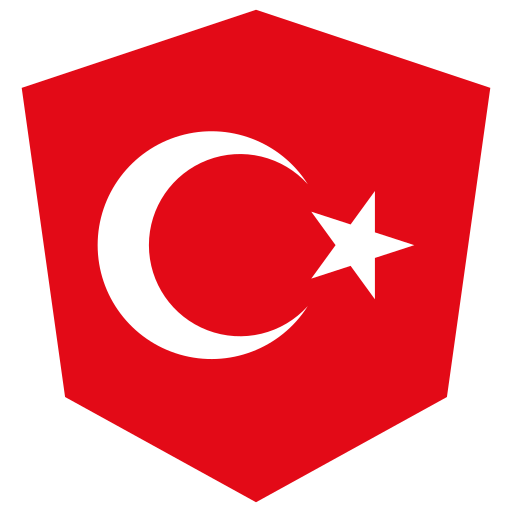

  <samp>
    {{ erKam | kæm }} · Döner kebab in developer form 🌯
  </samp>

  <samp>
    <picture><source media="(prefers-color-scheme: light)" srcset="https://raw.githubusercontent.com/erkamyaman/erkamyaman/main/slide-ng-mark-light.png"></picture> building <a href="https://github.com/slide-ng/slide.ng">slide.ng</a>, Slidev-style slides in markdown with Angular · <a href="https://slide-ng.dev">slide-ng.dev</a> 
     building <a href="https://github.com/erkamyaman/capacitor-foldable">Capacitor Foldable</a>: fold state, hinge angle and iPhone Duo support for Capacitor apps · <a href="https://erkamyaman.github.io/capacitor-foldable/">docs</a> 
     building <a href="https://github.com/pangular-inspector/devtools">Pangular Inspector</a>, the unified Angular DevTools, with <a href="https://github.com/santoshyadavdev">@santoshyadavdev</a> · <a href="https://pangular-inspector.dev">pangular-inspector.dev</a> 
     translating the Angular docs into Turkish · <a href="https://angular-docs.tr">angular-docs.tr</a> 
     contributing to <a href="https://github.com/ng-native/ng-native">Angular Native</a>, the great work of <a href="https://github.com/ashley-hunter">@ashley-hunter</a> · <a href="https://github.com/ng-native/ng-native/pulls?q=sort%3Aupdated-desc+is%3Apr+state%3Aclosed+author%3Aerkamyaman">see my work</a> 
     contributing daily to our BELOVED <a href="https://github.com/angular/angular">Angular</a> (docs, docs-infra) · <a href="https://github.com/angular/angular/pulls?q=sort%3Aupdated-desc+is%3Apr+state%3Aclosed+author%3Aerkamyaman">see my work</a> 
     if you see Angie in a random place on angular.dev, that was probably me
  </samp>

  <samp>
    <picture><source media="(prefers-color-scheme: light)" srcset="https://wsrv.nl/?url=github.com/erkamyaman.png&w=56&h=56&fit=cover&mask=circle&mbg=ffffff&output=png"></picture> <a href="https://erkamyaman.dev">me</a> &nbsp;
     <a href="https://x.com/erkamyaman_ng">tweets</a> &nbsp;
     <a href="https://www.linkedin.com/in/erkamyaman">linkedin</a> &nbsp;
     <a href="mailto:erkamyaman35@gmail.com">email</a> &nbsp;
     <a href="https://github.com/sponsors/erkamyaman">sponsor</a>
  </samp>

